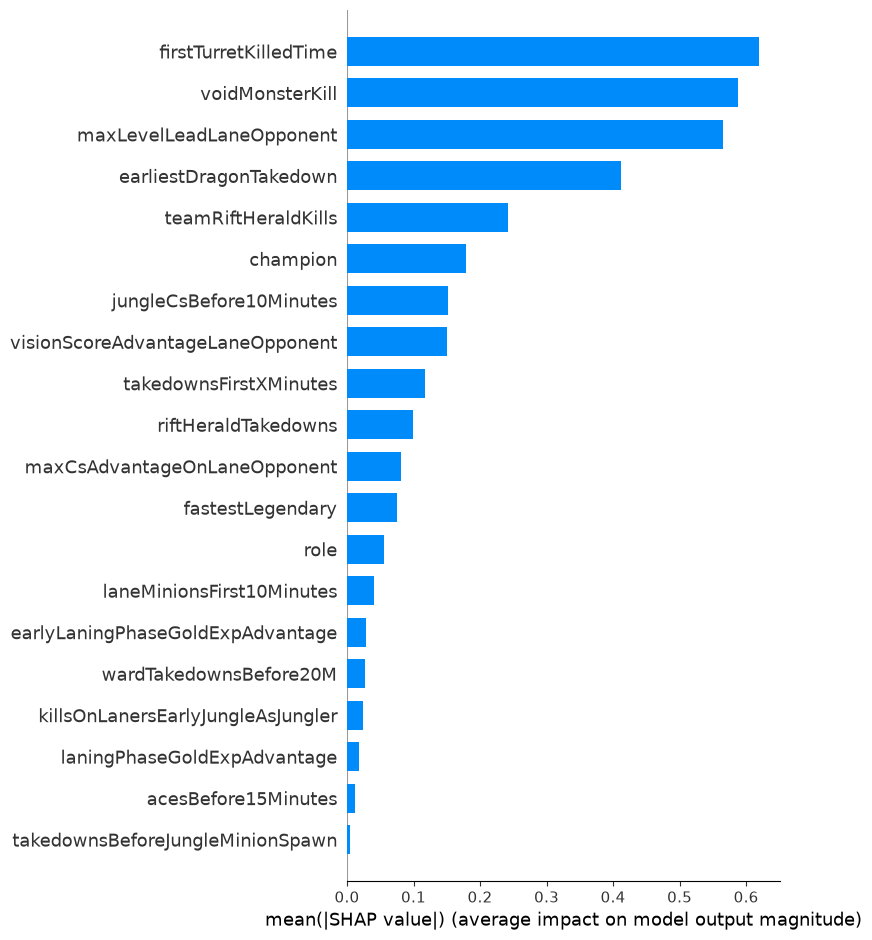
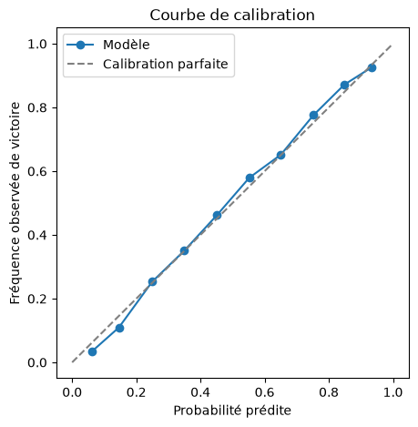

# LOL Assistant — Un plan de jeu League of Legends à partir d'une composition

[](https://github.com/mimouniahmed/LOL-assistant/actions/workflows/tests.yml)


Pipeline de données **de bout en bout** : collecte de **12 482 parties classées** via l'API Riot Games, modèle **XGBoost** de prédiction de victoire, explicabilité **SHAP**, puis rédaction d'un **plan de jeu** en langage naturel par un LLM (API Claude).

**Question** : face à une composition donnée (5 champions contre 5), sur quels faits de jeu une équipe doit-elle concentrer ses efforts, et via quel champion ?

```
Riot API ──► SQLite ──► pandas ──► XGBoost + SHAP ──► classement des faits ──► LLM ──► CLI
(ingestion)  (brut)    (features)   (modèle)          par composition          (plan de jeu)
```

## Résultats clés

| | |
|---|---|
| **Données** | 12 482 parties collectées par *snowball sampling*, dont 12 346 parties 5v5 valides, soit **123 460 lignes** (match × joueur) et 173 champions |
| **Modèle** | XGBoost sur 27 faits de début de partie + champion + rôle, split 60/20/20 **par match** |
| **Performance (test)** | Accuracy **0,780**, ROC-AUC **0,860**, F1 0,786, log loss 0,465, Brier 0,152 (référence naïve : 0,50) |
| **Calibration** | Quasi parfaite : quand le modèle annonce 70 % de victoire, l'équipe gagne effectivement ~70 % du temps |
| **Explicabilité** | Importance SHAP globale + **interactions champion × fait** (4 844 couples), agrégées en un classement propre à chaque composition |
| **Produit** | Une CLI qui prend 10 champions, saisis à la main ou lus depuis une partie en cours, et renvoie un plan de jeu argumenté |

<p align="center">
  
  
</p>

## Points techniques marquants

- **Détection et correction de fuites de données**, la partie la plus délicate du projet :
  - `maxKillDeficit` valait toujours 0 chez les perdants : le champ encodait presque le résultat. La règle de détection a été généralisée à tous les champs, plutôt que traitée au cas par cas ;
  - un premier modèle trop bon (AUC 0,887) était dominé par `earliestBaron`. Le Baron n'apparaît qu'à 20:00 (patch 2026, vérifié), donc ce champ ne pouvait pas être un fait précoce : il s'agissait d'une erreur de classification et non d'un signal. Après correction, l'AUC passe à 0,860 et l'importance est répartie sur des faits légitimes ;
  - `turretPlatesTaken` était supposé borné à 14 min, mais le patch 26.01 a supprimé cette limite. Vérifié empiriquement (jusqu'à 41 plaques dans les données), le champ a été exclu.
- **Séparer causes et conséquences** : une équipe qui gagne accumule tours et kills *parce qu'elle gagne déjà*. Le modèle n'utilise donc que des faits de début de partie (avant ~20 min), triés parmi 128 champs Riot.
- **Granularité adaptée à la question** : une ligne par (match, joueur) plutôt que par équipe, pour garder le lien champion ↔ fait. Les champs « équipe » et « joueur » sont distingués empiriquement, car Riot ne les documente pas.
- **Évaluation rigoureuse** : `GroupShuffleSplit` par `match_id`, pour que les 10 lignes d'un match ne soient jamais à cheval entre train et test. Recherche d'hyperparamètres sur la validation avec arrêt anticipé, puis une seule évaluation sur le test.
- **De l'attribution SHAP au conseil** : pour une composition hypothétique, les faits ne sont pas observés. Le classement combine l'importance globale et la **plus forte** interaction parmi les 5 champions (le maximum et non la somme, qui diluait le signal), pour produire un conseil du type « priorise ce fait, via ce champion ».
- **Ingestion robuste** : client Riot avec rate limiting **proactif** (fenêtre glissante, 100 appels / 120 s) et retry sur `429`, BFS de collecte qui reprend là où il s'était arrêté, filtrage des modes hors sujet (Arena, ARAM).
- **Abandon argumenté d'une première approche** : une Factorization Machine sur des embeddings de champions. Son terme de contre symétrique (`dot(A,B) = dot(B,A)`) ne peut porter aucun signal quand l'attribution bleu/rouge est arbitraire.
- **Industrialisation** : package Python installable, commande `lol-assistant`, validation des entrées (faute de frappe → suggestion du champion le plus proche), tests `pytest` sans réseau, intégration continue GitHub Actions.

➡️ **[Journal technique détaillé](docs/journal.md)** (chaque décision, erreur et correction, phase par phase) · **[Guide d'exploration Power BI](docs/powerbi_guide.md)**

## Exemple d'utilisation

```
$ lol-assistant
=== LOL Assistant — plan de jeu ===

1. Saisir les deux compositions à la main
2. Récupérer la composition depuis la partie en cours d'un joueur (Riot ID)
Choix [1/2] : 1
Votre équipe (5 champions séparés par des virgules) : Jayce, Sylas, Yone, Yunara, Lulu
Équipe adverse (5 champions séparés par des virgules) : Darius, Lee Sin, Ahri, Jinx, Thresh
```

Pour cette équipe, le classement fait ressortir `voidMonsterKill` (via Jayce), `firstTurretKilledTime` (Yone), l'avance de niveau en lane (Sylas), le premier dragon et l'avantage de vision (Lulu). Le LLM transforme ce classement, ainsi que celui de l'équipe adverse, en plan de jeu rédigé.

## Installation

```bash
git clone https://github.com/mimouniahmed/LOL-assistant.git
cd LOL-assistant
python -m venv .venv && source .venv/bin/activate
pip install -r requirements.txt
pip install -e ".[dev]"
cp .env.example .env       # renseigner RIOT_API_KEY et ANTHROPIC_API_KEY
pytest                     # tests unitaires, sans réseau ni clé
```

Les données (`data/` : base SQLite, modèle, artefacts SHAP) ne sont pas versionnées. Pour les reconstituer : `python scripts/collect_dataset.py <heures>`, puis exécuter `notebooks/03_model_training.ipynb`, qui produit le modèle et les artefacts SHAP lus par la CLI.

## Structure du projet

```
├── lol_assistant/               # package Python
│   ├── riot_client.py           # client Riot API (Account, Match-V5, Spectator-V5)
│   ├── rate_limiter.py          # rate limiting proactif à fenêtre glissante
│   ├── database.py              # stockage SQLite (JSON brut, dédoublonnage)
│   ├── crawler.py               # collecte snowball (BFS), filtre de mode de jeu
│   ├── game_plan.py             # classement des faits par composition + prompt + LLM
│   ├── live_game.py             # composition lue depuis une partie en cours
│   └── cli.py                   # interface en ligne de commande
├── notebooks/
│   ├── 01_riot_api_basics.ipynb       # exploration de l'API Riot
│   ├── 02_dataset_collection.ipynb    # pipeline de collecte
│   ├── 03_model_training.ipynb        # features, fuites, XGBoost, SHAP
│   └── 04_llm_game_plan.ipynb         # génération du plan de jeu
├── scripts/collect_dataset.py   # collecte longue durée, bornée dans le temps
├── tests/                       # tests pytest (sans réseau)
└── docs/                        # journal technique, guide Power BI, figures
```

## Limites

- Les classements reflètent des **corrélations** apprises sur de la solo queue EUW, pas des effets causaux. Certains indicateurs de lane (`maxLevelLeadLaneOpponent`) restent en partie des conséquences d'une lane qui se passe bien.
- Le LLM complète les données avec sa connaissance générale du jeu : le plan final n'est donc pas traçable à 100 % aux statistiques.
- Piste d'amélioration documentée dans le journal : reconstruire les features depuis l'API Timeline (instantanés à 10, 15 et 20 min) plutôt que depuis les agrégats `challenges` de Riot.

---

**Ahmed Mimouni** · [ahmedmimouni.fr](https://ahmedmimouni.fr) · [LinkedIn](https://www.linkedin.com/in/ahmed-mimouni-10b4413a2/) · [GitHub](https://github.com/mimouniahmed)
